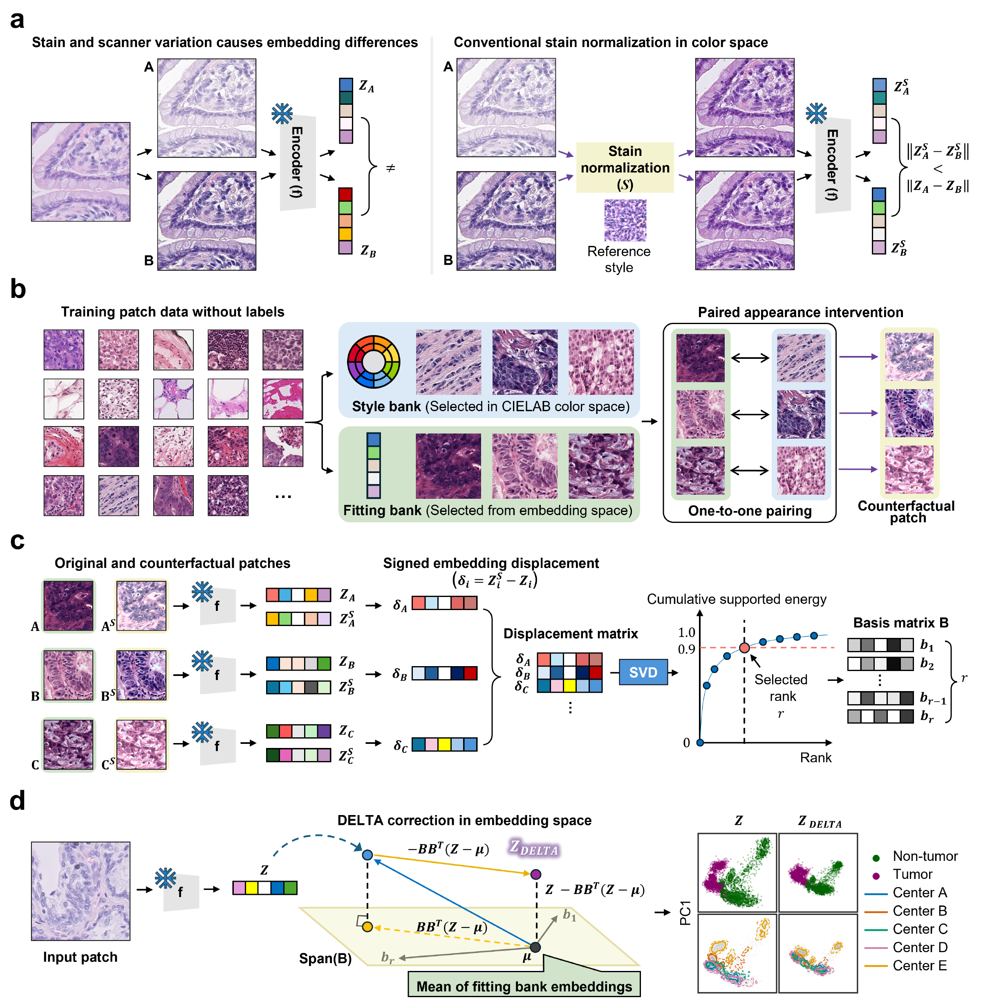

[Preprint](https://www.biorxiv.org/content/10.64898/2026.11.18.767727v1) · [Inputs](docs/INPUTS.md) · [Commands](docs/COMMANDS.md) · [License](LICENSE)

DELTA provides training-free, label-free correction of stain-associated variation in pathology foundation model embeddings. This repository contains evaluation, statistical analysis and numerical reporting code for the study.



## Code availability

The core DELTA implementation will be released before publication. Bank construction, counterfactual generation, operator estimation and embedding projection are not included here. End-to-end execution currently requires the unreleased DELTA module. The retained evaluation and reporting code consumes externally supplied embeddings, predictions and completed results.

## Quick start

From the repository root with Python 3.10–3.12, install the evaluation dependencies and run the synthetic tests.

```bash
python -m pip install -e ".[test,reporting]"
python -m pytest -q -m "not models"
```

The tests check evaluation formulas, statistical comparisons and CSV/Excel exports. They do not run DELTA correction or recreate the manuscript results. Downstream learners and exact normative k-nearest-neighbour scoring require the optional `models` dependencies. See [Commands](docs/COMMANDS.md).

## Evaluations

- Patch-level representation and classification
- Patch-aggregated classification
- WSI-level survival analysis
- HUMC normative screening
- Staining and scanner variation
- Spatial molecular prediction

Actual images, embeddings, cohort records, labels, split assignments, reference statistics and results are not distributed. HUMC data cannot be transferred outside the institution. Input requirements and the retained evaluation modules are described in [Inputs](docs/INPUTS.md).

## License

All rights are reserved. Software use, modification, derivative works, redistribution and commercial exploitation require prior written permission from the authorized rights holders. Korean patent application No. 10-2026-0205252 was filed on 22 October 2026, and PCT filing is in progress. No patent license is granted. See [LICENSE](LICENSE).
